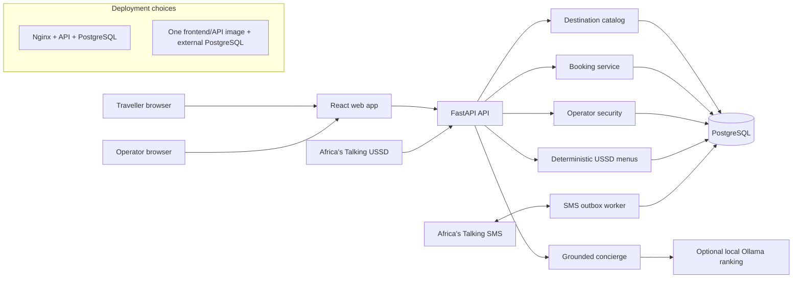
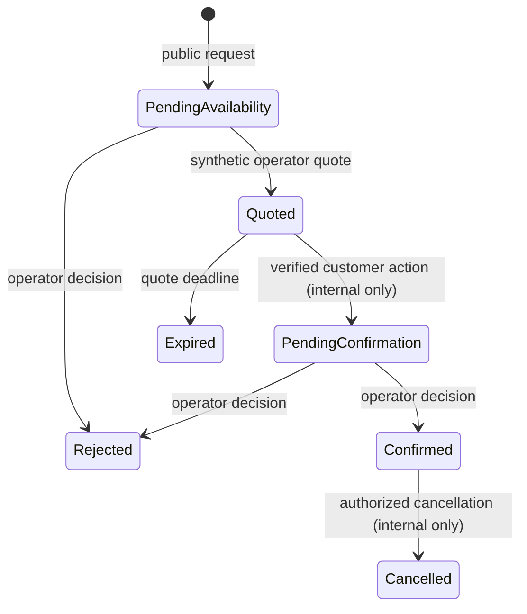
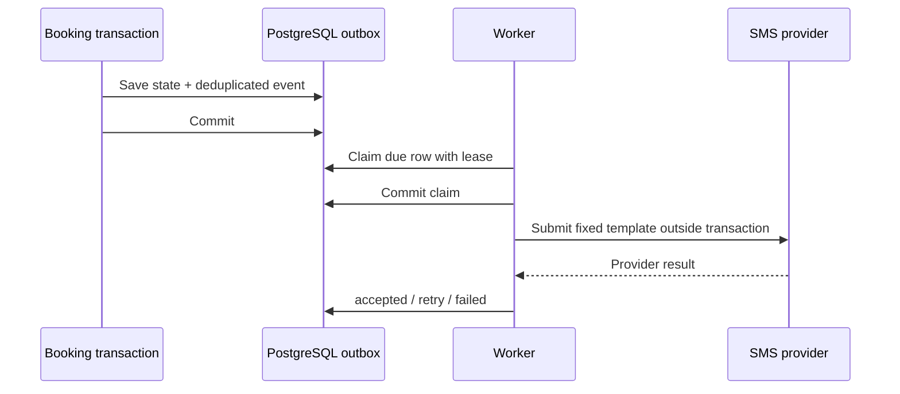

# SafariSmart AI Concierge Architecture

## Implemented scope

SafariSmart is a modular-monolith hackathon MVP. One FastAPI application owns validation, catalog grounding, booking rules, operator authorization, SMS scheduling, and USSD menus; PostgreSQL is the system of record. React is deployed either behind Nginx in the local Compose stack or as static files served by FastAPI in the single-image Marketplace build.

The product intentionally submits **booking requests**, not real reservations. It has no live inventory, payments, provider booking API, or verified customer account. All operator quotes and confirmations available in the demo are visibly synthetic.

## Runtime view

## Component boundaries

- **React client:** landing page, catalog, planner/chat, booking form, operator login, and protected dashboard. It never stores operator passwords; the short-lived access token is kept in per-tab `sessionStorage`, removed on sign-out, and never placed in URLs or long-lived `localStorage`.
- **FastAPI transport:** Pydantic validation, route-level dependencies, CORS allowlist, form parsing, and response serialization.
- **Catalog service:** active destinations, search/filter/pagination, repeatable seed data, and public reference content.
- **Concierge service:** deterministic recommendations and optional ranking through a narrow provider interface. It cannot invoke booking actions.
- **Booking service:** idempotent public submission and the authoritative state machine. It writes state and history atomically.
- **Operator security:** Argon2 password verification, signed short-lived tokens with issuer/audience/expiry checks, active-account checks, token-version revocation, and organization-scoped resource lookup.
- **Notification service:** consent-aware fixed templates and a transactional outbox. Provider calls happen after the booking transaction commits.
- **USSD service:** synchronous, deterministic English/Kiswahili menus derived from cumulative input. It performs no LLM or booking lookup.
- **Provider adapters:** Africa's Talking Sandbox/production SDK, PII-safe local SMS provider, and optional Ollama JSON ranking.
- **Persistence:** SQLAlchemy 2.x sessions and explicit Alembic migrations; application startup never creates schema implicitly.

## Data model

The implemented schema contains:

- `operators`: organizations, active flag, and a synthetic-demo marker
- `operator_users`: organization identity, Argon2 password hash, active flag, token version, and timestamps
- `destinations`: curated public content, category, region, featured/active state, and optional operator assignment
- `booking_requests`: reference, destination, assigned organization, travel data, minimized customer/contact data, consent, idempotency fingerprint, current status, and timestamps
- `booking_status_history`: old/new status, actor type/reference, reason, and timestamp
- `booking_quotes`: one synthetic quote per booking, amount/currency/expiry/terms, and explicit demo disclaimer
- `sms_notifications`: deduplicated event, safe template metadata, delivery state, attempt/lease fields, controlled error code, provider identifier, and timestamps

`DATABASE_URL` must use PostgreSQL in deployed environments. Tests use isolated temporary SQLite files for speed plus a destructive PostgreSQL integration test only when `TEST_DATABASE_URL` points to a disposable database.

## Public and protected API boundaries

| Method | Path | Boundary |
| --- | --- | --- |
| `GET` | `/api/health` | Public process health |
| `GET` | `/api/v1/destinations` | Public active catalog search/filter |
| `GET` | `/api/v1/destinations/{id}` | Public active destination detail |
| `POST` | `/api/v1/concierge/plan` | Public, validated, catalog-grounded plan |
| `POST` | `/api/v1/concierge/chat` | Public, bounded catalog question |
| `POST` | `/api/v1/bookings` | Public submission; idempotency header required |
| `POST` | `/api/v1/ussd` | Public Africa's Talking form callback; read-only |
| `POST` | `/api/v1/auth/token` | Existing operator login; no registration |
| `GET` | `/api/v1/operator/me` | Authenticated active operator identity |
| `GET` | `/api/v1/operator/bookings` | Organization-scoped PII-minimized queue |
| `GET` | `/api/v1/operator/bookings/{reference}` | Owning organization only |
| `POST` | `/api/v1/operator/bookings/{reference}/quote` | Synthetic organization only; audited |
| `POST` | `/api/v1/operator/bookings/{reference}/reject` | Valid operator state only; audited |
| `POST` | `/api/v1/operator/bookings/{reference}/confirm` | Only from `pending_confirmation`; audited |

Missing and cross-organization booking references both return `404`, preventing resource-existence leaks. There is no public booking list/detail, arbitrary SMS endpoint, customer status lookup, operator self-registration, or customer action endpoint.

## Booking workflow

The public endpoint creates `pending_availability`, never `confirmed`. Direct operator confirmation from `pending_availability` or `quoted` is rejected. A verified-customer context is required for the internal `quoted → pending_confirmation` edge; no HTTP route exposes that edge in this MVP because a booking reference or contact detail is not identity proof.

Every accepted state transition locks the request, validates the actor/resource/state, updates the current value, writes a history row, and schedules any eligible SMS event in the same transaction. Quote expiry and rejection reasons are validated. The LLM has no path to this service.

## Grounded concierge boundary

The fallback planner is the default and works offline. It:

1. Loads active destinations from the catalog.
2. Scores only supported interests, optional region, and featured state.
3. Returns at most four known destinations and 1–14 itinerary days.
4. Treats TZS budget as planning context, never as a source of price estimates.
5. Emits a disclaimer that the result is not price, availability, or reservation.

When `AI_PROVIDER=ollama`, the provider receives only allowed destination slugs and bounded preferences. Its only accepted output is a unique ordering of known slugs. Descriptions, facts, itinerary text, and safety wording still come from the application. Unknown/duplicate slugs, malformed output, timeout, or provider failure fall back to deterministic ranking and report `rule_based_fallback`. Injection-like chat instructions are ignored and produce a bounded safety response.

## SMS delivery architecture

Scheduling and sending both require explicit consent, phone preference, and a valid international number. Fixed English/Kiswahili templates omit names, email, requests, and travel detail. Workers use `FOR UPDATE SKIP LOCKED` on PostgreSQL, claim tokens, leases, bounded exponential retry, and PII-free result logs. `--drain` is suitable for a bounded job; the default command polls continuously.

`SMS_PROVIDER=local` performs validation without a network call and is rejected in staging/production. `SMS_PROVIDER=africastalking` uses the official SDK and requires an internally consistent Sandbox or production credential set. Provider acceptance is recorded as `accepted`, not `delivered`.

The remaining rare at-least-once window is a worker crash after provider acceptance but before the database update because this SDK send operation does not accept SafariSmart's idempotency key. Delivery-report callbacks remain disabled until provider-supported authenticity controls are designed.

## USSD boundary

Africa's Talking sends `sessionId`, `serviceCode`, `phoneNumber`, and cumulative `text` as form fields to `/api/v1/ussd`. SafariSmart validates lengths/formats, hashes the session identifier for a process-local sliding-window limit, stores none of the submitted subscriber data, and returns an Africa's Talking-compatible `CON` or `END` body.

Destination rows are loaded only when the current menu needs them. A database error produces a generic terminal response. The endpoint never invokes the LLM, exposes customer/booking data, accepts payment, or claims availability/prices. A production edge should add a shared limiter and the strongest callback/source controls supported by the provider.

## Deployment models

### Local Compose

`compose.yaml` runs PostgreSQL 16, a FastAPI image, and an Nginx-served frontend. It uses a persistent named database volume, health checks, migrations and destination seed on API startup, and an optional `sms-worker` profile. Credentials are supplied from the ignored local environment.

### Single-image Marketplace package

`marketplace/Dockerfile` uses a Node build stage and a non-root Python 3.12 runtime. FastAPI validates and serves the compiled Vite distribution, preserves API `404` responses, applies migrations, loads repeatable seed data, respects the platform `PORT`, and exposes `/api/health`. PostgreSQL remains an external per-instance dependency.

### Configuration safety

Production rejects missing/weak `AUTH_SECRET_KEY`, the implicit local database URL, debug mode, and the local SMS provider. Secrets belong in the runtime's secret store, not the image, repository, callback URL, logs, or frontend bundle. Each customer instance should receive separate database and provider credentials.

## Verification

Two GitHub Actions workflows cover the project:

- Backend CI: Python 3.12, PostgreSQL service, Alembic upgrade, and the full test suite including PostgreSQL integration.
- Frontend and Container CI: Node.js 24 install/test/build/audit, Compose validation and smoke test, and single-image build.

Local verification includes the isolated backend suite, frontend tests/typecheck/build, dependency audit, migration checks, and browser smoke tests. Container execution depends on Docker availability and must not be reported as locally verified when Docker is absent.

## Deliberate limitations

- No live inventory, real operator partnership, accommodation/restaurant/transport data, payment, or external reservation API
- No customer authentication, lookup, quote acceptance, cancellation, or status history API
- No durable chat history or cross-channel customer identity
- No production operator administration, password reset, MFA, or automated signing-key rotation
- No authenticated delivery-report or inbound SMS callback
- Process-local rather than distributed USSD rate limiting
- Ollama is optional ranking assistance, not a source of tourism facts or booking authority

The customer-access threat decision is in [customer-booking-access.md](customer-booking-access.md); channel operations are in [sms-notifications.md](sms-notifications.md) and [ussd-tourism.md](ussd-tourism.md).
