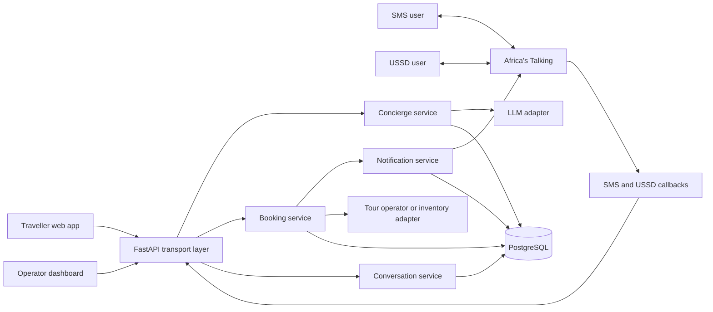
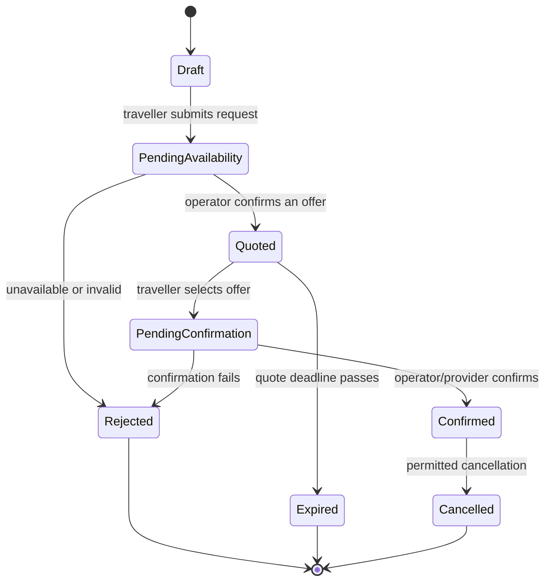
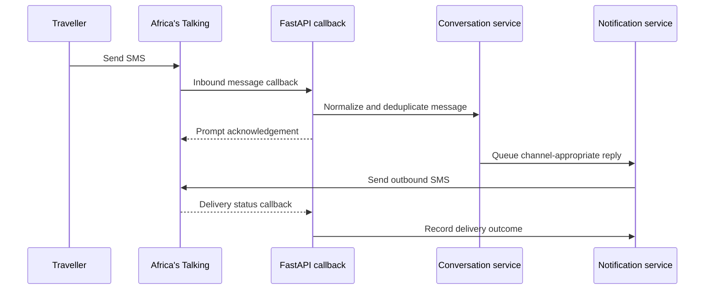

# SafariSmart AI Concierge Architecture

## Status and scope

This document describes the proposed target architecture. Phase 1 implements only the FastAPI application foundation and `GET /api/health`; components marked as planned should guide later phases rather than be treated as deployed functionality.

The architecture favors a modular monolith for the hackathon: one deployable backend with explicit internal boundaries. This keeps deployment and operations simple while allowing high-volume or integration-heavy modules to be extracted later if needed.

## Design goals

- Make tourism discovery accessible through web, SMS, and USSD channels.
- Keep booking decisions deterministic and auditable; the LLM may assist but cannot confirm a booking by itself.
- Isolate external providers behind adapters so sandbox and production implementations can be exchanged safely.
- Protect credentials and minimize stored personal data.
- Make inbound callbacks idempotent and outbound notifications observable.
- Keep USSD interactions short and responsive while allowing longer-running AI work on web and SMS channels.

## Proposed components

### Client channels

- **Traveller web app:** destination discovery, concierge chat, and booking-request tracking.
- **Operator dashboard:** review requests, publish availability or offers, and update booking states.
- **SMS:** asynchronous, low-bandwidth concierge messages and booking notifications.
- **USSD:** short, menu-based discovery and booking-request capture on basic phones.

### Backend modules

- **Transport layer:** FastAPI routes, request validation, authentication, rate limits, and response serialization.
- **Concierge service:** conversation orchestration, retrieval of trusted tourism content, and controlled LLM calls.
- **Conversation service:** channel-neutral sessions and messages so a traveller can be assisted consistently.
- **Booking service:** booking commands, state transitions, validation, availability checks, and audit history.
- **Notification service:** message templates, delivery attempts, retry policy, and provider status updates.
- **Provider adapters:** narrow interfaces for the LLM, Africa's Talking, and tour-operator or inventory systems.
- **Persistence layer:** repositories and transactions backed by PostgreSQL.

### Initial data domains

- Travellers and their communication preferences
- Operators, destinations, activities, and accommodation listings
- Conversations and messages with channel metadata
- Booking requests, offers, status history, and traveller consent
- Notification attempts and provider message identifiers
- Integration events and idempotency keys

## API boundaries

All JSON responses will use documented schemas. Business rules belong in services rather than route handlers, and database models must not be returned directly.

| Boundary | Proposed endpoint | Responsibility | Access |
| --- | --- | --- | --- |
| Platform health | `GET /api/health` | Report that the API process is available | Public; implemented |
| Concierge | `POST /api/v1/conversations/{id}/messages` | Accept a traveller message and return or queue an assistant response | Authenticated session; planned |
| Destinations | `GET /api/v1/destinations` | Search curated tourism inventory | Public, rate-limited; planned |
| Booking commands | `POST /api/v1/bookings` | Create a validated booking request with an idempotency key | Authenticated session; planned |
| Booking queries | `GET /api/v1/bookings/{id}` | Return the request and its permitted status history | Traveller or operator authorization; planned |
| Operator actions | `POST /api/v1/bookings/{id}/offers` | Record availability and an operator offer | Operator authorization; planned |
| SMS callback | `POST /api/webhooks/africas-talking/sms` | Normalize an inbound SMS or delivery update | Provider callback controls; planned |
| USSD callback | `POST /api/ussd` | Advance a short-lived USSD menu session | Provider callback controls; planned |

External callbacks must be rate-limited, validated against provider-supported controls, assigned an internal correlation ID, and processed idempotently. The API must acknowledge callbacks quickly; work that does not affect the immediate response should run outside the request path.

## Booking workflow

The booking service, not the LLM, owns the workflow and allowed transitions.

1. The concierge or form collects destination, dates, party size, preferences, contact channel, and consent.
2. The booking service validates required data and creates a draft using a client-provided idempotency key.
3. Submission moves the request to `pending_availability` and asks an operator or inventory adapter for availability.
4. An available option becomes a time-limited quote; unavailable or invalid requests are rejected with a reason.
5. The traveller selects a quote. Any payment workflow introduced later must use a dedicated payment provider and must never expose payment credentials to the LLM.
6. The operator or booking provider confirms the reservation before the state becomes `confirmed`.
7. The notification service sends an SMS or web update and records the provider message ID and delivery state.
8. Every transition records the actor, timestamp, correlation ID, and reason for auditability.

Commands must reject invalid state changes, duplicate callbacks, expired quotes, and unauthorized access. PostgreSQL transactions should update the booking and its status history atomically.

Phase 2 implements these rules as an internal workflow service with row locking and resource-scoped authorization facts. Booking detail and status-management endpoints remain intentionally unavailable until authenticated customer and operator identities can be securely bound to the corresponding booking or operator. Public callers can submit a request, but they cannot inspect it or advance its status.

## Africa's Talking integration

### SMS flow

- Convert provider fields into a channel-neutral message model and retain the provider ID for deduplication.
- Normalize phone numbers to an agreed format before lookup, and store only the data required for the service.
- Keep SMS replies concise and split messages deliberately to control cost and readability.
- Retry only transient failures with bounded backoff; permanent failures should be visible to operators.
- Use separate sandbox and production settings, sender configuration, and callback URLs.

### USSD flow

USSD is synchronous. Africa's Talking sends the session identifier, service code, phone number, and accumulated user input to the callback. The application will load the short-lived session, apply a deterministic menu transition, and return either `CON` to continue or `END` to close the session.

The callback path must not wait for an LLM response. Initial menus should support destination browsing and booking-request capture with small, numbered choices. Session state can begin in PostgreSQL with an expiry timestamp; a dedicated low-latency store can be introduced if traffic or response-time measurements justify it.

### Integration security and operations

- Load credentials only from runtime secrets or environment variables; never store them in source control.
- Use HTTPS callback URLs and the strongest callback authentication or source validation supported by the provider configuration.
- Redact API keys, phone numbers, and message content from routine logs.
- Track callback latency, send success, delivery status, retry count, and cost-related metrics.
- Correlate inbound events, booking commands, LLM calls, and outbound messages without exposing secrets.

## LLM boundary

The LLM adapter receives the minimum context needed for a response. It may suggest destinations, summarize verified content, and identify booking details, but all tool inputs must be schema-validated. The booking service revalidates extracted values and enforces authorization and state transitions.

Prompts and retrieved content are untrusted input. The system should resist prompt injection, avoid placing secrets in model context, label uncertain information, and provide a human handoff when confidence or safety requirements are not met.

## Deployment direction

Docker will package the frontend and backend, with PostgreSQL provided as a managed service or separate container. Deployments should expose only the web/API entry points, run database migrations as a controlled release step, and include liveness and readiness checks. Production secrets must come from the deployment platform rather than committed files.
