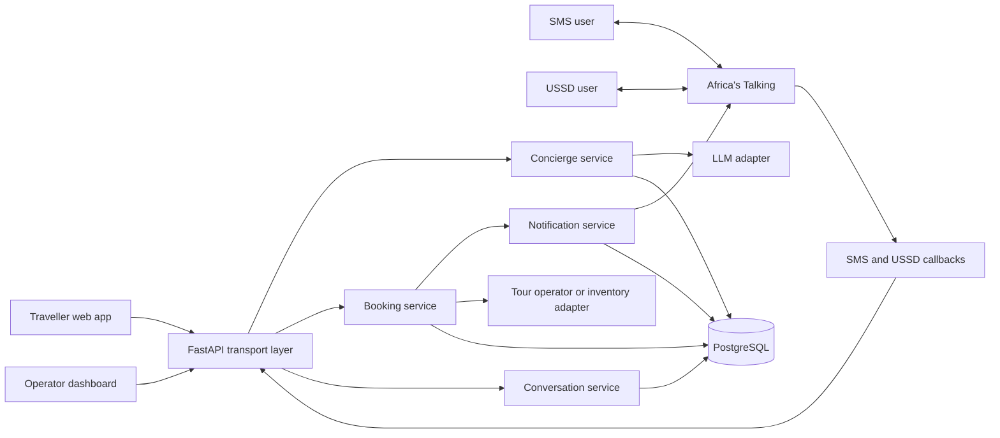
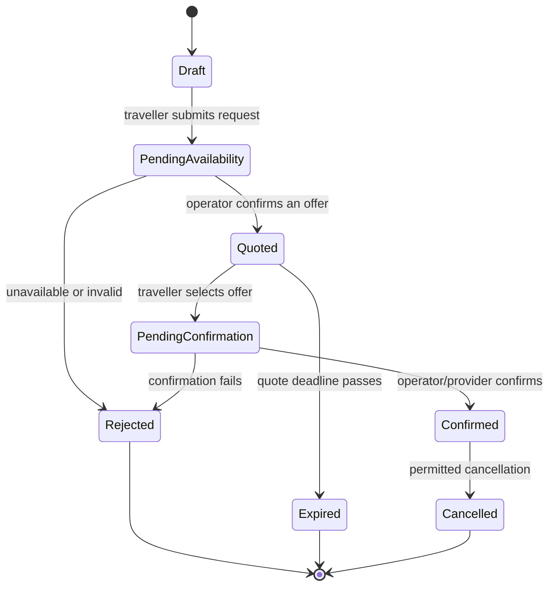
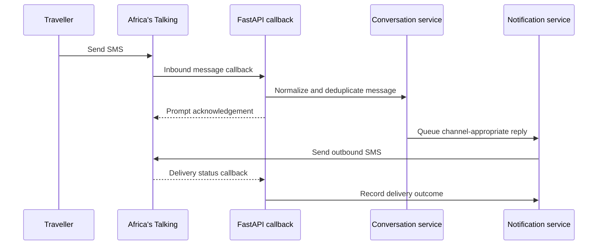

# SafariSmart AI Concierge Architecture

## Status and scope

This document describes both the implemented Phase 3 backend and the proposed target architecture. Phase 3 implements the FastAPI foundation, SQLAlchemy persistence, Alembic migrations, a public destination catalog, idempotent booking request submission, operator authentication and authorization, protected booking management, and an audited workflow. Components marked as planned should guide later phases rather than be treated as deployed functionality.

The architecture favors a modular monolith for the hackathon: one deployable backend with explicit internal boundaries. This keeps deployment and operations simple while allowing high-volume or integration-heavy modules to be extracted later if needed.

## Design goals

- Make tourism discovery accessible through web, SMS, and USSD channels.
- Keep booking decisions deterministic and auditable; the LLM may assist but cannot confirm a booking by itself.
- Isolate external providers behind adapters so sandbox and production implementations can be exchanged safely.
- Protect credentials and minimize stored personal data.
- Make inbound callbacks idempotent and outbound notifications observable.
- Keep USSD interactions short and responsive while allowing longer-running AI work on web and SMS channels.

## System components

The API, booking service, PostgreSQL persistence boundary, destination catalog, operator security boundary, and protected workflow are implemented. The web clients, concierge, notifications, provider adapters, and Africa's Talking paths in the following target diagram remain planned.

### Client channels

- **Traveller web app:** destination discovery, concierge chat, and booking-request tracking.
- **Operator dashboard:** review requests, publish availability or offers, and update booking states.
- **SMS:** asynchronous, low-bandwidth concierge messages and booking notifications.
- **USSD:** short, menu-based discovery and booking-request capture on basic phones.

### Backend modules

- **Transport layer:** FastAPI routes, request validation, authentication, rate limits, and response serialization.
- **Concierge service:** conversation orchestration, retrieval of trusted tourism content, and controlled LLM calls.
- **Conversation service:** channel-neutral sessions and messages so a traveller can be assisted consistently.
- **Booking service:** booking commands, state transitions, validation, availability checks, and audit history.
- **Notification service:** message templates, delivery attempts, retry policy, and provider status updates.
- **Provider adapters:** narrow interfaces for the LLM, Africa's Talking, and tour-operator or inventory systems.
- **Persistence layer:** repositories and transactions backed by PostgreSQL.

### Initial data domains

- **Implemented:** operators, operator identities, curated destinations, booking requests, traveller contact preferences and consent, booking status history, synthetic demo quotes, and idempotency keys.
- **Planned:** activities, accommodation inventory, offers, conversations, messages, notifications, provider identifiers, and general integration events.

## Persistence and migrations

SQLAlchemy 2.x models define operators, operator users, destinations, booking requests, booking status history, and one-to-one synthetic booking quotes. Production configuration uses a PostgreSQL URL supplied through `DATABASE_URL`; FastAPI creates request-scoped sessions and disposes its connection pool during shutdown.

Alembic owns schema changes. The migration chain creates the Phase 2 domain schema, adds operator identities and organization flags, and adds synthetic booking quotes. Revisions define relationships, uniqueness rules, check constraints, indexes, and timestamps. Application startup does not create tables implicitly. Operators must run `alembic upgrade head` before serving traffic.

The explicit destination seed operation inserts Serengeti National Park, Ngorongoro Conservation Area, Mount Kilimanjaro, Zanzibar, and Tarangire National Park. It is idempotent by destination slug and contains no live availability, pricing, or partnership data.

## Authentication and authorization boundary

Operator passwords are hashed with Argon2 through `pwdlib`; plaintext passwords are never stored. Login accepts the OAuth2 password form and issues a short-lived HS256 access token containing a user identifier, operator identifier, token version, unique token identifier, issued/not-before/expiry timestamps, issuer, and audience. Decoding fixes the permitted algorithm and requires every claim, signature, expiry, issuer, and audience to validate.

Authentication then reloads the operator user and organization from the database on every protected request. Inactive users and revoked token versions receive `401`; an inactive organization receives `403`. Each booking query also constrains the resource by the authenticated organization identifier. Cross-organization and nonexistent booking references both return `404` so the endpoint does not disclose another organization's records.

No public registration endpoint exists. A development-only CLI creates an explicitly synthetic operator from locally supplied credentials and can assign only unassigned curated destinations. Staging and production reject missing or weak signing secrets, the default local database URL, and debug mode.

## API boundaries

All JSON responses will use documented schemas. Business rules belong in services rather than route handlers, and database models must not be returned directly.

| Boundary | Proposed endpoint | Responsibility | Access |
| --- | --- | --- | --- |
| Platform health | `GET /api/health` | Report that the API process is available | Public; implemented |
| Destination catalog | `GET /api/v1/destinations` | Search, filter, and paginate active curated destinations | Public; implemented |
| Destination detail | `GET /api/v1/destinations/{id}` | Return one active curated destination | Public; implemented |
| Booking submission | `POST /api/v1/bookings` | Validate and create an idempotent pending request | Public submission; implemented |
| Operator login | `POST /api/v1/auth/token` | Exchange an existing operator identity for a short-lived token | Public login; implemented |
| Operator identity | `GET /api/v1/operator/me` | Resolve the current active user and organization | Operator token; implemented |
| Operator queue | `GET /api/v1/operator/bookings` | List assigned requests with PII-minimized summaries | Operator token; implemented |
| Operator booking detail | `GET /api/v1/operator/bookings/{reference}` | Return assigned booking detail, quote, and audit history | Assigned operator; implemented |
| Synthetic quote | `POST /api/v1/operator/bookings/{reference}/quote` | Record a clearly labelled demo quote and move to `quoted` | Assigned demo operator; implemented |
| Operator rejection | `POST /api/v1/operator/bookings/{reference}/reject` | Reject from a permitted state with an audit reason | Assigned operator; implemented |
| Operator confirmation | `POST /api/v1/operator/bookings/{reference}/confirm` | Confirm only from `pending_confirmation` | Assigned operator; implemented |
| Concierge | `POST /api/v1/conversations/{id}/messages` | Accept a traveller message and return or queue an assistant response | Authenticated session; planned |
| Customer booking access | No route exposed | Await verified account or out-of-band challenge delivery | Deferred by security decision |
| SMS callback | `POST /api/webhooks/africas-talking/sms` | Normalize an inbound SMS or delivery update | Provider callback controls; planned |
| USSD callback | `POST /api/ussd` | Advance a short-lived USSD menu session | Provider callback controls; planned |

External callbacks must be rate-limited, validated against provider-supported controls, assigned an internal correlation ID, and processed idempotently. The API must acknowledge callbacks quickly; work that does not affect the immediate response should run outside the request path.

## Booking workflow

The booking service, not the LLM, owns the workflow and allowed transitions.

Public submission creates a request directly in `pending_availability`; it never creates a confirmed booking. The internal workflow implements the remaining state edges shown below.

1. The concierge or form collects destination, dates, party size, preferences, contact channel, and consent.
2. The booking service validates required data and creates a draft using a client-provided idempotency key.
3. Submission moves the request to `pending_availability` and asks an operator or inventory adapter for availability.
4. An available option becomes a time-limited quote; unavailable or invalid requests are rejected with a reason.
5. The traveller selects a quote. Any payment workflow introduced later must use a dedicated payment provider and must never expose payment credentials to the LLM.
6. The operator or booking provider confirms the reservation before the state becomes `confirmed`.
7. The notification service sends an SMS or web update and records the provider message ID and delivery state.
8. Every implemented transition records the actor type and reference, timestamp, and reason for auditability. A cross-service correlation identifier remains planned for external integrations.

Commands must reject invalid state changes, duplicate callbacks, expired quotes, and unauthorized access. PostgreSQL transactions should update the booking and its status history atomically.

Phase 3 exposes the operator-permitted edges through organization-scoped HTTP endpoints. An assigned operator can quote or reject `pending_availability`, reject `pending_confirmation`, and confirm only `pending_confirmation`; direct confirmation from `pending_availability` is rejected. Every accepted action writes status history in the same transaction. Quote records are available only to explicitly synthetic demo operators and carry disclaimers that they are neither live availability nor real reservation offers.

Customer transitions remain internal because the application cannot yet bind a caller to a booking through a verified account or communication channel. Tests can simulate a verified customer context to prove the complete state graph, but the production API exposes no customer lookup, acceptance, cancellation, or status-change route.

## Phase 3 security and privacy boundaries

- Booking submission responses omit names, email addresses, phone numbers, consent records, and special requests.
- The public API exposes no booking list, detail, audit-history, customer decision, or status-change endpoint.
- A client-supplied idempotency key can replay only the same normalized booking input; conflicting reuse is rejected.
- Destination identifiers must resolve to active catalog records before a booking is accepted.
- Operator list responses omit customer PII; protected detail is available only to the assigned, active organization.
- Missing, malformed, expired, wrong-audience, wrong-issuer, revoked, and inactive-user tokens are rejected without executing operator actions.
- Customer and operator workflow actors carry resource-scoped authorization facts rather than relying on references supplied by callers.
- Operator-only transitions include quoting, rejection, and confirmation. The LLM and unauthenticated callers cannot confirm bookings.

Phase 3's customer-access threat model and deferral decision are documented in [customer-booking-access.md](customer-booking-access.md). Booking references and contact details are not authentication factors, so customer lookup and action endpoints remain absent until a verified account or out-of-band challenge channel exists.

## Africa's Talking integration

### SMS flow

- Convert provider fields into a channel-neutral message model and retain the provider ID for deduplication.
- Normalize phone numbers to an agreed format before lookup, and store only the data required for the service.
- Keep SMS replies concise and split messages deliberately to control cost and readability.
- Retry only transient failures with bounded backoff; permanent failures should be visible to operators.
- Use separate sandbox and production settings, sender configuration, and callback URLs.

### USSD flow

USSD is synchronous. Africa's Talking sends the session identifier, service code, phone number, and accumulated user input to the callback. The application will load the short-lived session, apply a deterministic menu transition, and return either `CON` to continue or `END` to close the session.

The callback path must not wait for an LLM response. Initial menus should support destination browsing and booking-request capture with small, numbered choices. Session state can begin in PostgreSQL with an expiry timestamp; a dedicated low-latency store can be introduced if traffic or response-time measurements justify it.

### Integration security and operations

- Load credentials only from runtime secrets or environment variables; never store them in source control.
- Use HTTPS callback URLs and the strongest callback authentication or source validation supported by the provider configuration.
- Redact API keys, phone numbers, and message content from routine logs.
- Track callback latency, send success, delivery status, retry count, and cost-related metrics.
- Correlate inbound events, booking commands, LLM calls, and outbound messages without exposing secrets.

## LLM boundary

The LLM adapter receives the minimum context needed for a response. It may suggest destinations, summarize verified content, and identify booking details, but all tool inputs must be schema-validated. The booking service revalidates extracted values and enforces authorization and state transitions.

Prompts and retrieved content are untrusted input. The system should resist prompt injection, avoid placing secrets in model context, label uncertain information, and provide a human handoff when confidence or safety requirements are not met.

## Verification and CI

The default test suite uses isolated SQLite databases for fast service, route, validation, security, and migration coverage. A separate PostgreSQL integration test is enabled only when `TEST_DATABASE_URL` is present. It requires an already migrated disposable database, verifies the database is at the Alembic head, then exercises operator login, organization isolation, quoting, invalid direct confirmation, verified-customer state simulation, confirmation, and audit history.

GitHub Actions runs on Python 3.12 with an isolated PostgreSQL service. It installs the backend development dependencies, applies `alembic upgrade head`, and runs the complete suite. The integration test deletes application-domain rows before and after its run, so its database must never be shared with valuable or production data.

## Deployment direction

Docker will package the frontend and backend, with PostgreSQL provided as a managed service or separate container. Deployments should expose only the web/API entry points, run database migrations as a controlled release step, and include liveness and readiness checks. Production secrets must come from the deployment platform rather than committed files.
