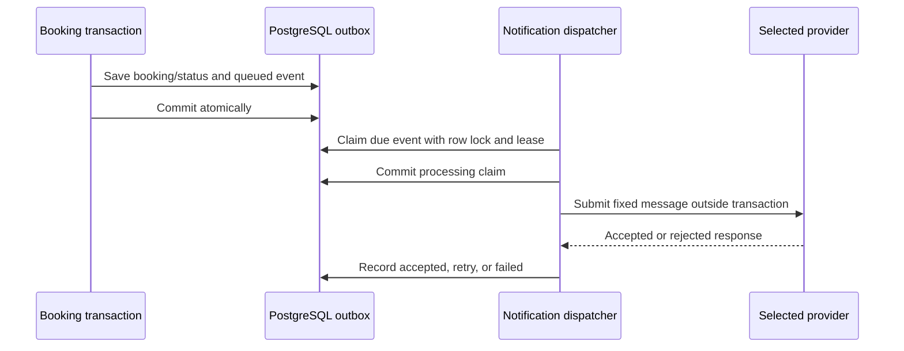

# Booking notifications and Africa's Talking Sandbox

## Implemented scope

SafariSmart implements booking-scoped email through the Resend HTTPS API and SMS through the official Africa's Talking Python SDK. The customer chooses one channel; SafariSmart never silently falls back to the other channel and does not expose a public or operator-facing arbitrary-notification endpoint.

Five fixed notification events are available in English and Swahili:

| Event | Safety wording |
| --- | --- |
| Booking request received | States that availability is pending and the request is not confirmed |
| Booking status updated | Labels the current status and says demo statuses do not prove a reservation |
| Synthetic quote available | Says the quote is synthetic, not live availability or a real offer |
| Booking rejected | Says no real-world reservation was made |
| Synthetic confirmation | Says the demo state does not prove a real reservation |

Messages contain the booking reference and pending/demo status but omit the customer's name, special requests, and other booking details. Scheduling and sending both recheck customer consent, the selected contact preference, and the matching validated recipient. A booking creates at most one selected-channel job; it never creates both an email and an SMS job.

## Email configuration

Email is disabled by default and uses HTTPS rather than SMTP:

```dotenv
EMAIL_ENABLED=false
RESEND_API_KEY=
RESEND_FROM_EMAIL=
RESEND_FROM_NAME=SafariSmart AI Concierge
RESEND_TIMEOUT_SECONDS=5
```

Enable email only after Resend confirms that the sender domain is verified. The API key is represented by Pydantic `SecretStr` and must never appear in source, logs, screenshots, exceptions, or frontend configuration. A successful Resend API response records `accepted`; it is not proof of inbox delivery. SafariSmart supplies the deterministic notification key as Resend's `Idempotency-Key` so retrying the same outbox event does not intentionally submit a duplicate.

## SMS configuration

SMS is sandbox-first and disabled by default:

```dotenv
SMS_ENABLED=false
SMS_PROVIDER=africastalking
AFRICASTALKING_ENVIRONMENT=sandbox
AFRICASTALKING_USERNAME=
AFRICASTALKING_API_KEY=
AFRICASTALKING_SENDER_ID=
```

Credentials are loaded from the ignored root `.env` file. The API key is represented by Pydantic `SecretStr`; it must never be printed, logged, placed in an exception, or committed. For an offline local demonstration, set `SMS_PROVIDER=local` with `SMS_ENABLED=true`. That provider validates the same phone/message boundary but performs no network request and logs no PII; it is rejected in staging and production.

When SMS is enabled, username and API key must both exist. Sandbox configuration requires the username `sandbox`; production configuration rejects that username. Blank, short, and placeholder API keys are rejected. The Sandbox test command additionally refuses to run when the configured provider environment is production.

## Transactional outbox



Each event has a deterministic idempotency key based on booking reference, event kind, state, language, and selected channel. Public booking replay therefore does not create a second received notification. Workflow row locking and the unique outbox key protect transition notifications.

Workers claim one event with `FOR UPDATE SKIP LOCKED` on PostgreSQL, set a unique claim token and lease, increment the attempt count, and commit before any network call. Other workers cannot claim the same unexpired event. A transient provider or network failure returns the event to `queued` with bounded exponential backoff; permanent rejection or retry exhaustion becomes `failed`.

Resend accepts the event key as a provider idempotency key. Africa's Talking does not expose an idempotency key in this SDK operation, so a dispatcher crash after SMS acceptance but before the database update can cause an at-least-once retry. Claim tokens prevent concurrent sends, but production monitoring must still detect this rare SMS crash window.

### Notification states

- `queued`: due now or after a retry delay.
- `processing`: leased by one worker; no delivery claim is made.
- `accepted`: the selected provider accepted the API request and returned, or omitted, a message identifier.
- `delivered`: a later provider delivery report states success.
- `failed`: provider rejection, delivery failure, invalid permission state, or retry exhaustion.
- `unknown`: an unrecognized delivery report or stale worker result.

Only controlled error codes are stored. Provider exception text, credentials, recipient numbers, and message bodies are not persisted in the outbox or routine worker results.

### Dispatcher commands

Run continuously from `backend/`:

```bash
python -m app.cli.notification_worker
```

Process only currently due rows and exit:

```bash
python -m app.cli.notification_worker --drain --max-messages 100
```

Continuous mode polls with a five-second default delay; `--poll-seconds` changes it. The dispatcher checks configuration and database connectivity before claiming a row. Its summaries contain counts and controlled state only, never recipients or message bodies. Docker Compose exposes the dedicated dispatcher through the legacy optional `sms` profile.

The web process also drains a small bounded batch after a successful booking commit, on process startup, and periodically while the instance remains active. These attempts never block the booking response. On sleeping free hosting, due rows remain durable in PostgreSQL and resume when the web instance wakes. A continuously supervised dispatcher remains the recommended production upgrade; fake keep-alive traffic is not part of the design.

## Sandbox Simulator check

Africa's Talking documents that Sandbox interactions occur in the Simulator rather than on a real handset. The official Python SDK requires the Sandbox username to be `sandbox`.

1. Create or open the Africa's Talking Sandbox application.
2. Register the designated test number in the [Simulator](https://simulator.africastalking.com:1517/).
3. Put the Sandbox API key in the ignored `.env` file and enable SMS:

   ```dotenv
   SMS_ENABLED=true
   AFRICASTALKING_ENVIRONMENT=sandbox
   AFRICASTALKING_USERNAME=sandbox
   AFRICASTALKING_API_KEY=<sandbox-api-key>
   ```

4. From `backend/`, explicitly run:

   ```bash
   python -m app.cli.send_sandbox_sms --simulator-number +2557XXXXXXXX
   ```

5. The command reports only whether the provider accepted the request and its message ID. Confirm receipt in the Simulator inbox or Sandbox dashboard session logs.

The command accepts no message argument and always sends a fixed statement that no real booking or reservation was created. It never falls back to production or chooses a number automatically.

Official references:

- [Africa's Talking official Python SDK](https://github.com/AfricasTalkingLtd/africastalking-python)
- [Africa's Talking Sandbox setup](https://help.africastalking.com/en/articles/1170660-how-do-i-get-started-on-the-africa-s-talking-sandbox)
- [Sandbox versus live environments](https://help.africastalking.com/en/articles/2189460-what-are-the-sandbox-and-the-live-environments)
- [SMS acceptance and delivery stages](https://help.africastalking.com/en/articles/742491-why-did-my-messages-fail)

## Production requirements and limitations

Before live notifications are enabled, SafariSmart still needs:

- A verified Resend domain, restricted API key, monitored sender, bounce/complaint handling, and an authenticated delivery-event design for production email.
- A production Africa's Talking application, API key, approved sender identity, balance, and country-specific compliance.
- Deployment of the implemented dispatcher as a separate continuously supervised process, with queue-age/failure monitoring and graceful shutdown, when hosting permits it.
- An authenticated or otherwise provider-validated delivery-report callback route that calls the internal delivery-state recorder.
- Secret rotation, metrics, alerts for queue age and failure rate, and an operational retry/dead-letter policy.
- Load and concurrency validation against the production PostgreSQL configuration.

Provider API acceptance is not confirmed delivery. Sandbox API acceptance is not real handset delivery and must never be presented as a confirmed booking, operator partnership, or reservation.
